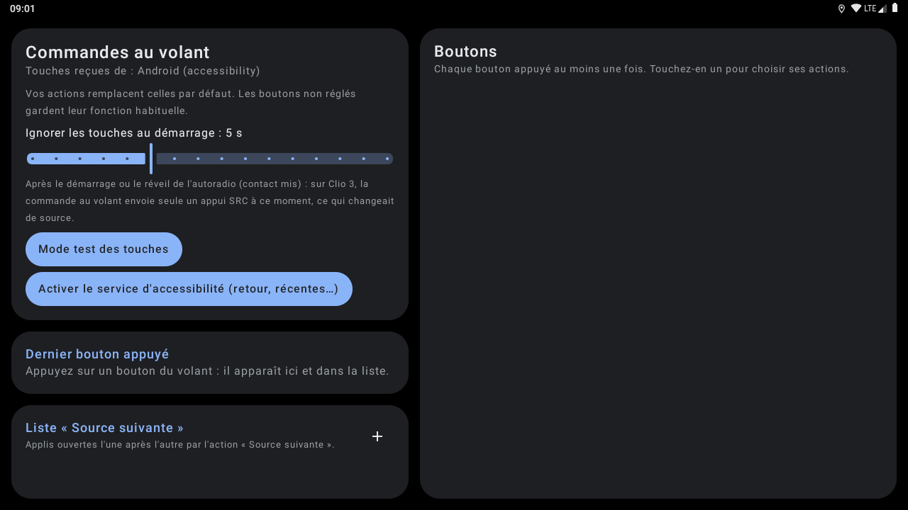
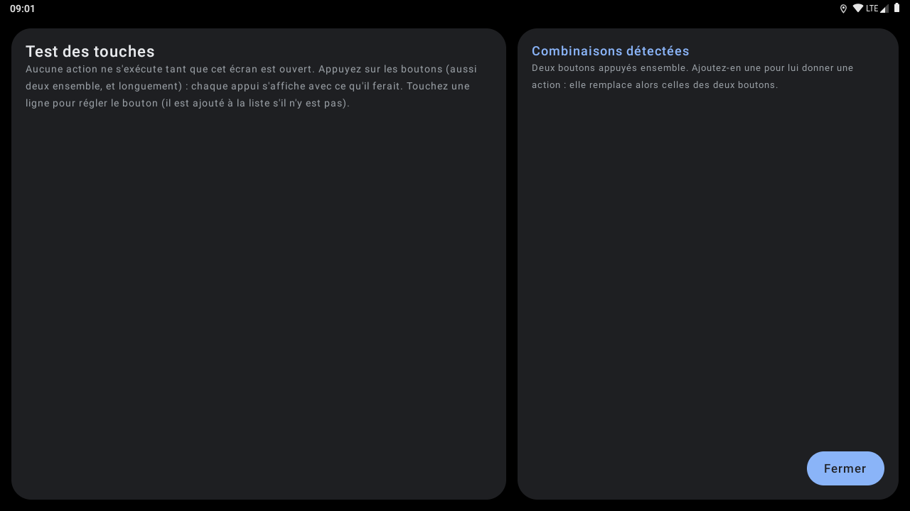
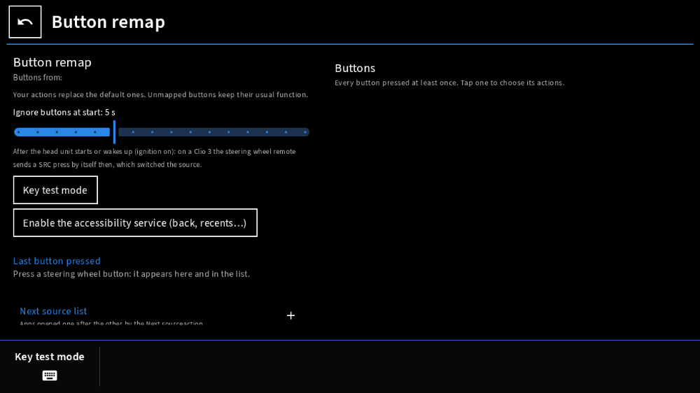
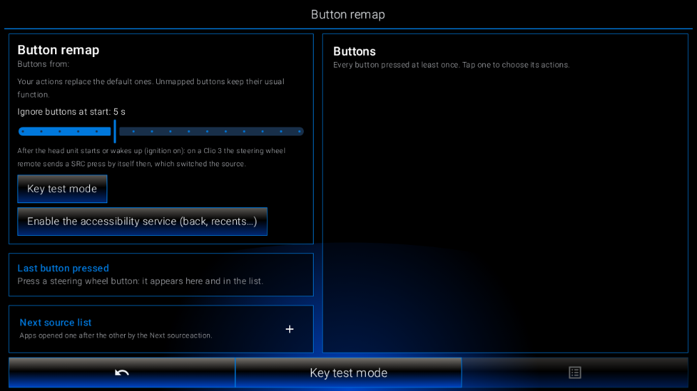

# LibreHU BtnRemap — commandes au volant

Choisissez vous-même l'action de chaque bouton du volant (ou du boîtier CAN), en **appui court** et **appui long** :
ouvrir une appli, « source suivante » dans **votre** liste d'applis, **source suivante / précédente de
[LibreHU EasySource](https://github.com/LibreHU/LibreHU-EasySource-app)** (sélecteur de sources pour la touche MODE / SRC), lecture / pause, piste suivante / précédente,
volume, muet, accueil, retour, navigation, assistant vocal, téléphone… Les boutons s'ajoutent tout seuls à la liste
quand on les appuie (apprentissage), et l'app suit le thème clair / sombre et la couleur d'accent de LibreHU Launcher.

- **Mode test des touches** (bouton du premier encadré) : écran plein où aucune action ne s'exécute ; chaque
  événement s'affiche (appuyé / relâché, puis appui court, long ou combinaison, et l'action qu'il donnerait). Toucher une
  ligne règle le bouton, et l'ajoute à la liste s'il n'y était pas.
- **Combinaisons** : deux boutons appuyés ensemble (le second pendant que le premier est tenu, ou moins de 650 ms
  après la dernière impulsion d'un bouton du boîtier CAN). Elles apparaissent dans « Combinaisons détectées » du mode
  test ; une fois ajoutée et réglée, la combinaison remplace les actions des deux boutons (ni appui long, ni action au
  relâchement, ni répétition du volume). Ses boutons CAN sont aussi annoncés à LibreHU-service, qui ne fait alors plus
  rien pour eux.
- **Action par défaut affichée** : un bouton laissé sur « Défaut » montre entre parenthèses ce que l'autoradio en fait
  (branche `librehu-service` : volume, sourdine, navigation, MODE → applis, précédent / suivant, téléphone, accueil).
- **Appui long avec le boîtier CAN** : le boîtier Hiworld envoie une touche tenue comme une suite d'appuis de ~100 ms
  toutes les ~380 ms ; l'app les réunit (relâché seulement après 650 ms sans nouvel appui), donc l'appui long (0,6 s)
  marche. Un bouton sans appui long garde un appui court par répétition ; volume : un pas par répétition.
- **Touches ignorées au démarrage** (5 s par défaut, 0 à 15 s) : après le démarrage du service et quand l'écran se
  rallume (contact mis). Sur Clio 3, la commande au volant envoie seule un appui SRC à la mise du contact.

## Captures d'écran

| | |
|---|---|
| <br>Écran principal | <br>Écran principal (2) |
| <br>Mode test des touches |   |
| <br>Style Modularer Infotainment-Baukasten | <br>Style LHU-Link |

Captures sur l'émulateur Android 9 (1280×720, 160 dpi comme l'autoradio), sans autoradio branché : les valeurs du véhicule et de la MCU sont vides. Refaites-les avec l'action **Screenshots** de [LibreHU-OTA-app](https://github.com/LibreHU/LibreHU-OTA-app/tree/main/screenshots). Galerie : [librehu.github.io/screenshots/btnremap.html](https://librehu.github.io/screenshots/btnremap.html).

## Comment fonctionnent les commandes au volant sur l'UJC201 (d'origine)

```
bouton → boîtier CAN Hiworld → trame 0x11 (octet 6 & 0x1F = touche) → USART1 de la MCU → trame MCU 0x10
→ ivi-services (passthrough) → app CAN com.can.activity (décode, CanKey.TranslateKeyMap)
→ ICar.sendKeyToMcu(code IVIKey) → IVICore.postKey → KeyCodeUtil.onKeyEvent :
   1. diffuse com.jancar.services.action.key.event (key_event_id, key_event_type : 1 appui, 0 relâché, 2 clic)
   2. exécute l'action par défaut (volume → puce audio, MODE → ModeUtil, HOME, NEXT/PREV → média…)
```
La touche **MODE / SRC** fait défiler la liste `[ModeControl]` de `/jancar/config/ivi-settings.ini`
(`COUNT=6` : radio, musique, vidéo, musique BT, entrée AV, navigation). Les boutons à résistance (sans boîtier CAN)
arrivent en trame MCU `20` et passent par l'apprentissage de `com.jancar.steeringwheelkeys`.

## Branches

| Branche | Source des boutons | Les actions d'origine… |
|---|---|---|
| `main` | touches Android (service d'accessibilité) | sont remplacées pour les boutons réglés |
| `ivi` | diffusion `com.jancar.services.action.key.event` d'ivi-services | **s'exécutent aussi** (ivi-services n'offre aucun moyen de les bloquer) |
| `librehu-service` | trames du boîtier CAN Hiworld (`0x11`) et boutons à résistance (MCU `20`) via LibreHU-service | sont remplacées : l'app est seule à recevoir les boutons |

Code des boutons CAN : l'octet 6 **entier** (`can:<code>`). L'appli Hiworld n'en garde que les 5 bits bas, si bien
que deux boutons ne différant qu'au-dessus de 0x1F (SRC+ / SRC− signalés identiques sur Clio 3) avaient le même
code. Un code au-dessus de 0x1F encore sans action reprend celle de ses 5 bits bas (réglages d'avant).

### Branche `librehu-service` : une seule appli pour les touches du volant
LibreHU-service sait aussi transformer les touches du volant (`0x11`) en actions (onglet CAN, « Touches du volant »,
actif par défaut sans ivi-services). Les deux cohabitent : BtnRemap envoie au service la liste des boutons auxquels
vous avez donné une action (diffusion `org.librehu.service.CLAIM_KEYS`), et le service ne fait plus rien pour
ceux-là (une seule action par appui) ; les autres boutons gardent l'action du service. L'onglet CAN du service
affiche « Géré par LibreHU BtnRemap » sur ces boutons.

### Branche `ivi` : neutraliser MODE
ivi-services lance quand même son appli pour MODE. Avec root, on peut réduire sa liste à une appli inoffensive :
```
adb root
adb shell sed -i 's/^COUNT=6/COUNT=1/; s#^APP0=.*#APP0=org.librehu.btnremap/org.librehu.btnremap.MainActivity#' /jancar/config/ivi-settings.ini
```
(sauvegardez le fichier avant ; à refaire si le système le recopie depuis `/system/etc`).

## Installation
1. Installer l'APK avec [LibreHU Apps (OTA)](https://github.com/LibreHU/LibreHU-OTA-app), ou l'APK de la release `latest-<branche>` du dépôt (build *release* signé avec la clé commune des applis LibreHU ; les anciens APK de debug avaient chacun leur clé : désinstaller une fois avant), l'ouvrir : le service démarre (notification discrète).
2. Optionnel : activer le **service d'accessibilité** (Retour, Applis récentes, Notifications ; et sur `main`,
   indispensable pour recevoir les touches).
3. Appuyer sur chaque bouton du volant, puis le toucher dans la liste pour choisir ses actions.

Non testé sur l'autoradio à ce stade.

## Appli téléphone (LibreHU Bridge)

Réglable depuis le téléphone par l'appli LibreHU Bridge (Android et iPhone), à travers LibreHU-service : chaque bouton appris (nom, appui court et long, appli à ouvrir) et les boutons ignorés au démarrage.
Fournisseur `<paquet>.bridge` (`bridge/BridgeProvider.kt`), réservé aux applis signées avec la clé LibreHU (permission
`org.librehu.permission.BRIDGE`, vérifiée dans `call()` lui-même) ; format décrit dans
[LibreHU-service, docs/bridge.md](https://github.com/LibreHU/LibreHU-service/blob/main/docs/bridge.md).

## Optimisation (R8)

L'APK publié par la CI (`assembleRelease`) est **optimisé par R8** : code et ressources réduits et optimisés, ce qui
rend Jetpack Compose nettement plus fluide ([Compose performance](https://developer.android.com/develop/ui/compose/performance)),
**sans renommage** (`-dontobfuscate` dans `app/proguard-rules.pro`) : les traces des journaux restent lisibles. Les
règles gardent aussi ce qui n'est appelé que par son nom (méthodes natives, helpers root lancés par `app_process`). Si
une fonction plante avec « class / method not found », regarder `usage.txt` dans l'artefact *R8 reports* de la CI (ce
que R8 a retiré) et ajouter une règle `-keep`.

**Styles Modularer Infotainment-Baukasten et LHU-Link de LibreHU Launcher** : c'est le launcher qui les choisit et les demande à l'appli (il publie `style` = `factory` ou `ambient`, comme pour le style rétro) ; l'appli suit tout de suite : palette noire du style même en mode jour, coins carrés partout, police Source Sans 3 pour Modularer Infotainment-Baukasten (SIL OFL 1.1, `third_party/SourceSans3-LICENSE.md`), lettres fines pour LHU-Link. Rien à régler dans l'appli.

Les **fenêtres** (confirmations, choix, listes) suivent aussi le style : boîte noire à filet blanc (Modularer Infotainment-Baukasten) ou bleu nuit à filet d'accent (LHU-Link).

**Son des touches** : chaque toucher (sans glisser ni appui long) fait le petit son choisi dans LibreHU Launcher
(Paramètres → Personnalisation → Son des touches : un son par style parmi 26, ou aucun) ; le launcher le publie
(colonne / extra `click`), un launcher plus ancien donne le son par défaut de son style. Sons de LibreHU (synthétisés),
de **Kenney** ([kenney.nl](https://kenney.nl/assets/interface-sounds), CC0, version WAV de **Hugo Locurcio (Calinou)** :
[Calinou/kenney-interface-sounds](https://github.com/Calinou/kenney-interface-sounds)) et de l'**Android Open Source
Project** (sons tactiles, Apache 2.0) : détail et licences dans `third_party/KEYCLICK-SOUNDS.md`
(`res/raw/click_*.wav`, `ui/KeyClick.kt`).

L'écran prend aussi la **mise en page** de ces styles (éléments communs dans `ui/CarKit.kt`) : cadre du style
(**Modularer Infotainment-Baukasten** : Retour encadré, titre sur un trait de la couleur d'accent, touche du bas
« Mode test des touches », touches encadrées ; **LHU-Link** : titre, panneaux encadrés de la couleur d'accent, barre
du bas Retour / Mode test des touches / Options), panneaux et lignes carrés. Aucun logo, nom, icône, police ni image
d'un constructeur.

**Style rétro et police de LibreHU Launcher** : quand le launcher est en style rétro (les couleurs d'un afficheur
d'autoradio tirées de sa couleur d'accent, couleur RGB comprise), cette appli prend sa palette (jour ou nuit) ; quand
la **police d'afficheur à segments** y est choisie (dans tous les styles), cette appli la prend aussi, en majuscules
sans accents (« LibreHU Seg14 », tirée de DSEG14 © keshikan, SIL Open Font License 1.1, voir
`third_party/DSEG-LICENSE.txt`). Le launcher publie le style, la police et la palette par
`content://org.librehu.launcher.theme/theme` (colonnes `style`, `font`, `background`, `surface`, `surface_high`,
`on_accent`, `text`, `text_dim`) et par la diffusion `org.librehu.action.THEME_CHANGED` (mêmes noms en extras).

## Soutenir le projet

LibreHU est développé bénévolement, sur le temps libre, et toutes ses applis restent gratuites. Si le projet vous est
utile, vous pouvez le soutenir par un don sur [Liberapay](https://liberapay.com/DokT/donate) (association française à
but non lucratif, dons récurrents) :

[](https://liberapay.com/DokT/donate)
[](https://liberapay.com/DokT/)
